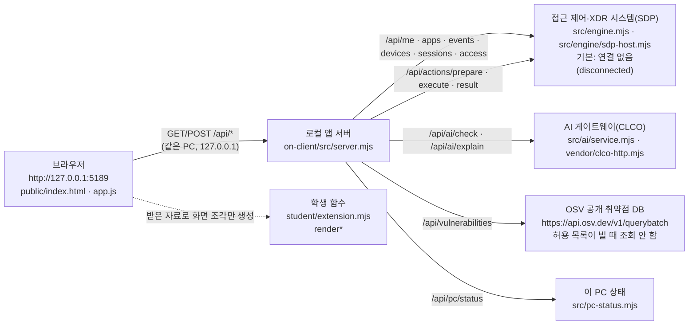

# 케셰브 학생용 실행 설명서와 시스템 구성도 (21단계)

작성: 정예린 (ALEPH 보안 과정 대전 C반) · 대상 프로젝트: `choi-bujang-secret-vault` 저장소의 `on-client` 폴더 (시작 틀 0.2.21)

이 문서는 학생이 새로 쓴 문서입니다. 제공 문서(`README.md`의 위쪽, `docs/STUDENT_LAUNCH_GUIDE.md`, `docs/CONNECTION_TROUBLESHOOT.md` 등)는 고치지 않았고, 여기서는 그 문서와 실제 코드를 대조해 이 프로젝트 기준으로 정리합니다.
표의 **확인 구분**은 다음 뜻입니다.

| 표시 | 뜻 |
|---|---|
| 실제 확인 | 학생이 이 PC에서 직접 실행해 본 결과 |
| 코드 확인 | 코드·설정 파일을 읽어서 확인한 내용(실행하지 않음) |
| 모의 점검 | 학생 함수에 가짜 입력을 넣어 그려 본 결과(실제 서버·화면 아님) |
| 미확인 | 아직 실행하거나 확인하지 않음. 성공으로 보지 않음 |

## 1. 목적과 기능

케셰브는 회사 직원이 **본인의** 로그인·기기·세션 상태, 업무 앱 접근 판정, 최근 접속 기록·XDR 경보를 한 화면에서 보는 보안 Agent 앱입니다. 관리자용 전체 감시 화면이 아닙니다.

| 단계 | 학생이 구현한 함수 (`student/extension.mjs`) | 화면 칸(`public/index.html`의 슬롯) | 기능 |
|---|---|---|---|
| 13 | `renderIdentity` | `student-identity` | 로그인 사용자·기기·세션 상태. unknown 은 「확인 불가」 |
| 14 | `renderDecision` | `student-decision` | 업무 앱 접근 판정 allow / deny / challenge / 확인 불가와 요청 실패 구분 |
| 15 | `renderEvents` | `student-events` | 접속 기록·XDR 경보 목록, 필터, 상세(근거·규칙·상태) |
| 16 | `renderStatus` | `student-status` | 연결 끊김·빈 목록·미지원 기능 안내, 도움정보 |
| 17 | `renderAiConnection` | `student-ai-connection` | 앱 안 AI 연결 점검 결과와 실패 이유 |
| 18 | `renderExplanation` | `student-explanation` | AI 설명을 선택한 기록의 근거·규칙·현재 상태와 연결. 근거 불일치는 사용하지 않음 |
| 19 | `renderAction` | `student-action` | 조치 제안·사람 확인·서버 접수(ACK)·효과 관측 구분 |
| 20 | `renderVulnerabilities` | `student-vulnerabilities` | 설치 패키지 정확한 버전의 OSV 조회 결과, 미조회·일부 실패 구분 |

모든 학생 함수는 `createStudentView()`가 돌려주며, 제공 화면(`public/app.js`)이 받은 자료를 넘겨 호출합니다. 학생 함수는 서버에 요청을 보내지 않고 `createElement`·`textContent`로 화면 조각만 만듭니다. (코드 확인)

## 2. 지원 환경과 버전

| 항목 | 값 | 근거 | 확인 구분 |
|---|---|---|---|
| 운영체제 | Windows 10/11 + PowerShell | 실행 도구가 `.ps1` | 코드 확인 |
| Node.js | 22~24 지원, 수업·검사 기준 **24.19.0** | `on-client/package.json`의 `engines.node: "24.19.0"`, `start-alekov.ps1`의 버전 검사 | 코드 확인 |
| 이 PC의 Node.js | 24.19.0 (13단계에서 v26.13.0 을 지우고 24.19.0 설치 후 실행 도구로 앱이 켜짐) | 학생 실행 기록 | 실제 확인 (설치 당시). 지금 버전은 `node -v`로 다시 확인 |
| npm 의존성 | 없음. `on-client`에는 `package-lock.json`이 없음 | `package.json`에 `dependencies` 없음 | 코드 확인 |
| 브라우저 | PC 브라우저(Chrome 등)로 `http://127.0.0.1:5189/` | `src/server.mjs`가 `127.0.0.1`에만 열림 | 코드 확인 |
| 지원하지 않는 환경 | macOS·Linux 실행 도구, 다른 PC·휴대폰에서 접속(127.0.0.1 전용), Node 25 이상 | 실행 도구·서버 코드 | 코드 확인 (해당 환경에서 실행해 보지 않음) |

## 3. 폴더 구조

```
choi-bujang-secret-vault\          ← Git 최상위(프로젝트 폴더). 커밋·제출은 여기서
├─ (1~12단계 자료실 파일: api\, src\, public\, scripts\ … — 이 문서 범위 밖, 건드리지 않음)
└─ on-client\                      ← 앱 폴더. 실행은 여기서
   ├─ package.json                 ← start / demo / check / package-app 스크립트
   ├─ .env.example                 ← 비밀 없는 설정 견본(포트·어댑터·모델·OSV 허용 목록 이름)
   ├─ tools\start-alekov.ps1       ← 실행 도구(Node 버전·포트·폴더 확인 후 서버 시작)
   ├─ src\server.mjs               ← 로컬 앱 서버(제공)
   ├─ src\engine.mjs, src\engine\  ← 기존 서버(SDP) 연결부(제공)
   ├─ src\ai\, vendor\clco-http.mjs← 앱 안 AI 게이트(CLCO) 연결부(제공)
   ├─ src\actions\                 ← 조치 준비·집행·결과 재조회(제공)
   ├─ src\vulnerabilities\         ← package-lock.json 읽기·OSV 조회(제공)
   ├─ public\app.js, index.html    ← 제공 화면(학생이 고치지 않음)
   ├─ student\extension.mjs        ← 학생 작성 파일(13~20단계 함수)
   ├─ student\engine-adapter.mjs   ← 기존 서버 연결 어댑터 견본(제공, 기본은 연결 없음)
   └─ docs\STUDENT_RUNBOOK.md      ← 이 문서(학생 작성)
```

## 4. 실행 절차

### 4-1. PowerShell 을 여는 위치

1. 파일 탐색기에서 `바탕 화면\choi-bujang-secret-vault\on-client` 폴더를 엽니다.
2. 주소 표시줄에 `powershell`을 입력하고 Enter. 또는 아무 PowerShell 창에서 아래 한 줄로 이동합니다.

```powershell
cd "$HOME\Desktop\choi-bujang-secret-vault\on-client"
```

### 4-2. 버전 확인

```powershell
node -v
```

`v24.19.0`(또는 v22~v24)이 나와야 합니다. `v26` 등이 나오면 실행 도구가 멈춥니다(6장).

### 4-3. 실행

```powershell
powershell -NoProfile -ExecutionPolicy Bypass -File .\tools\start-alekov.ps1
```

| 옵션 | 쓰는 때 |
|---|---|
| `-Port 5190` | 5189 를 다른 프로그램이 쓸 때. 브라우저 주소도 `:5190` |
| `-Demo` | 예제 자료로 화면만 볼 때. 실제 연결이 아님 |
| `-NoNativeHost` | 계정 연결 준비 없이 로컬 확인만 할 때 |
| `-Background` | 창 없이 실행. 안내된 프로세스 번호의 node 를 작업 관리자에서 종료 |
| `-SdpHostConfig "<담당자 안내 경로>"` | 담당자가 SDP 개인 설정을 안내한 경우에만 |

`npm start`(= `node src/server.mjs`)도 같은 서버를 켜지만 Node 버전·포트 확인을 하지 않습니다.

### 4-4. 정상 시작 신호

PowerShell 창에 아래 두 줄이 보이면 **로컬 서버가 응답한 것**입니다. AI·SDP 연결 성공이라는 뜻은 아닙니다.

- `케셰브가 켜졌습니다. 브라우저에서 http://127.0.0.1:5189/ 을 여세요.`
- `서버가 응답한 것만 확인했습니다. AI 연결 상태는 화면에서 따로 확인해 주세요.`

브라우저에서 `http://127.0.0.1:5189/`를 열어 위쪽 상태 표시와 「보호 현황」 화면이 보이면 정상입니다. (13단계에서 실제 확인. 이후 단계 화면은 6장 표의 확인 구분을 따름)

### 4-5. 종료와 다시 실행

- 종료: 실행한 PowerShell 창에서 `Ctrl+C`. 브라우저 주소가 더 이상 열리지 않으면 종료된 것입니다.
- 다시 실행: 같은 `on-client` 폴더에서 4-3 명령을 다시 실행합니다. 실행·종료는 내 파일을 바꾸지 않습니다.
- `student/extension.mjs`를 고친 뒤에는 브라우저 새로고침으로 다시 불러옵니다. 문법만 볼 때는 `npm run check`.

## 5. 시스템 구성도

### 5-1. Mermaid



### 5-2. 같은 내용을 글로

| 출발 | 도착 | 경로·파일 | 무엇을 주고받나 |
|---|---|---|---|
| 브라우저 | 로컬 앱 서버 | `http://127.0.0.1:5189/api/*` → `src/server.mjs` | 화면이 필요한 자료를 요청. 서버는 127.0.0.1 에서만 받음 |
| 로컬 앱 서버 | 접근 제어·XDR(SDP) | `src/engine.mjs`, `src/engine/sdp-host.mjs`, `student/engine-adapter.mjs` | 본인 신원·업무 앱·접근 판정·기록·기기·세션. 설정이 없으면 `ENGINE_NOT_CONNECTED`(연결 없음) |
| 로컬 앱 서버 | AI 게이트웨이(CLCO) | `src/ai/service.mjs`, `src/ai/connection.mjs`, `vendor/clco-http.mjs` | 연결 점검(모델 목록)과 사건 설명. 열쇠는 서버 쪽 보관함에만 있고 브라우저·학생 함수로 오지 않음 |
| 로컬 앱 서버 | 조치 처리 | `src/actions/service.mjs`, `src/actions/sdp-action-engine.mjs` | 준비 → 사람 확인 → 집행 전달 → 결과 재조회. 현재 기록은 `supportedActions`가 비어 실제 경로가 열리지 않음 |
| 로컬 앱 서버 | 이 PC 상태·도움정보 | `/api/pc/status` → `src/pc-status.mjs`, `/api/diagnostics` → `src/server.mjs` | 내 PC 점검 결과와 비밀값 없는 도움정보 |
| 로컬 앱 서버 | OSV | `src/vulnerabilities/project-scan.mjs`, `src/vulnerabilities/osv.mjs` | 담당자가 정한 프로젝트의 `package-lock.json`과 허용된 공개 패키지만 조회 |
| 제공 화면 | 학생 함수 | `public/app.js` → `student/extension.mjs`의 `createStudentView()` | 서버 응답을 검증한 사본을 넘기면 학생 함수가 DOM 조각을 돌려줌. 학생 함수는 요청을 보내지 않음 |

공개 가능한 주소만 적었습니다. 비밀 설정값(열쇠·토큰·인증서·개인 설정 파일 경로의 내용)은 적지 않습니다.

## 6. 장애 상황별 확인·복구 순서

코드의 실제 오류 처리(`tools/start-alekov.ps1`, `src/engine.mjs`, `public/app.js`, 학생 함수)와 연결했습니다. 자세한 오류 코드 전체는 `docs/CONNECTION_TROUBLESHOOT.md`에 있습니다.

| 장애 상황 | 화면·창에 보이는 것 | 확인 방법 | 복구 방법 |
|---|---|---|---|
| Node 없음·버전 다름 | `Node.js 가 없습니다` / `지금 Node.js 는 vXX 입니다` | `node -v` | Node 24.19.0 설치 후 PowerShell 새 창. (13단계에서 v26 → 24.19.0 으로 실제 복구) |
| PowerShell 이 npm 실행 차단 | `npm.ps1 … 스크립트를 실행할 수 없으므로` | 오류 문구 | `npm` 대신 `npm.cmd` 사용, 또는 4-3의 실행 도구 명령 사용 (실제 확인) |
| Git Bash 에서 실행 | `-File 매개 변수에 대한 인수 '.toolsstart-alekov.ps1'이(가) 없습니다` | 창 프롬프트가 `$`이면 Git Bash. Git Bash 는 `\`를 지움 | 경로를 슬래시로: `powershell -NoProfile -ExecutionPolicy Bypass -File ./tools/start-alekov.ps1` (22단계 재현에서 실제 확인) |
| 잘못된 폴더에서 실행 | `앱 폴더가 아닙니다` / npm `ENOENT` | 현재 위치(`pwd`) | 4-1 처럼 `on-client`로 이동 후 다시 실행 (실제 확인) |
| 포트 충돌 | `포트 5189 를 다른 프로그램이 쓰고 있습니다` | 창 메시지 | 그 프로그램은 두고 `-Port 5190` |
| 서버가 늦게 뜸 | `…초 안에 뜨지 않았습니다` | 창 메시지 전체 | 「도움정보 불러오기」→ 내용 확인 →「확인했으며 복사합니다」로 강사에게 |
| 기존 서버 연결 없음 | 학생 칸에 「연결 없음」, 코드 `ENGINE_NOT_CONNECTED` | `-SdpHostConfig`를 안 줬는지 | 정상 상태(학생 실수 아님). 담당자 설정 안내를 기다림 |
| 응답 형식 이상 | 「확인 불가」, `CONTRACT_MISMATCH` | 다시 불러오기 한 번 | 계속되면 도움정보를 담당자에게. 성공으로 보지 않음 |
| AI 연결 실패 | AI 연결 칸에 `ON_AI_PROVISIONING_PENDING`, `WB_CLCO_*` 등과 안내 | 17단계 `renderAiConnection`의 오류 묶음 | 계정 연결·앱 승인 확인. 자동 재시도 없음, 점검 버튼을 직접 누름 |
| AI 설명 실패·근거 불일치 | 「AI 설명 실패: [코드]」 또는 「AI 설명을 쓸 수 없습니다: 근거 불일치」 | 18단계 `renderExplanation` | 기록·판정은 그대로 사용. 성공 표식(`data-student-explanation-event`)이 붙지 않음 |
| 조치 결과 불명 | 「결과 불명(unknown)」 | 19단계 `renderAction` | 「연동 시스템 결과만 재조회」를 직접 누름. 같은 조치를 새로 집행하지 않음 |
| 패키지 미조회 | 「조회 준비 미완료(not_configured)」 / 「아직 조회 안 함(not_checked)」 | 20단계 `renderVulnerabilities` | 허용 목록은 담당자가 준비. 취약점 없음이 아님 |
| 패키지 조회 실패 | 「조회 실패 [코드]」 | 20단계 | 보호 현황의 설치 패키지 조회를 직접 다시 누름 |

## 7. 제공 코드와 학생 작성 부분의 경계

| 구분 | 파일 | 누가 | 학생이 고쳤나 |
|---|---|---|---|
| 학생 화면 함수 | `on-client/student/extension.mjs` | 학생 | 예 (13~20단계) |
| 학생 문서 | `on-client/docs/STUDENT_RUNBOOK.md`, `on-client/README.md` 맨 아래 「학생 작성 부분」 | 학생 | 예 (21단계) |
| 제공 화면 | `on-client/public/*` | 제공 | 아니요 |
| 로컬 앱 서버·연결부 | `on-client/src/*`, `on-client/vendor/*` | 제공 | 아니요 |
| 실행·포장 도구 | `on-client/tools/*` | 제공 | 아니요 |
| 제공 문서 | `on-client/docs/` 아래 기존 문서, `README.md` 위쪽 | 제공 | 아니요 |
| 1~12단계 자료실 | 저장소 최상위 `api/`, `src/`, `public/` 등 | 학생(3차) | 21단계에서는 건드리지 않음 |

## 8. 확인한 것과 확인하지 않은 것

| 기능 | 확인 구분 | 내용 |
|---|---|---|
| 실행 도구로 앱 켜기, 5189 접속 | 실제 확인 | 13단계에서 Node 24.19.0 으로 켜고 브라우저에서 화면 확인 |
| 13~17단계 학생 칸 표시 | 실제 확인 (각 단계 진행 때) | 연결 없음·예제 상태 기준. 실제 SDP 연결 상태는 아님 |
| 18단계 `renderExplanation` 상태별 표시 | 모의 점검 | 기록 없음·실패·요청 중·성공·근거 불일치·실행했다는 응답·제안 있음 |
| 19단계 `renderAction` 상태별 표시 | 모의 점검 | idle·prepared·pending·effectApplied 없는 succeeded→결과 불명·succeeded·다른 사건 결과·error |
| 20단계 `renderVulnerabilities` 상태별 표시 | 모의 점검 | 조회 전·조회 중·실패·not_configured·partial |
| 실제 SDP(접근 제어·XDR) 연결 | 미확인 | 개인 SDP 설정을 받지 않음 |
| 실제 AI 사건 설명 응답 | 미확인 | 유료 요청을 반복하지 않음 |
| 실제 조치 집행과 효과 관측 | 미확인 | `supportedActions`가 비어 실제 경로가 열리지 않음 |
| 실제 OSV 조회 결과 | 미확인 | 허용 목록은 담당자 준비 사항 |
| 새 폴더에서 처음부터 설치·재현 | 실제 확인(일부) | 22단계에서 커밋 8b399fc 를 새 폴더에 받아 서버 시작·첫 화면까지 확인. 종료·재실행 기록은 미확인. `docs/RELEASE_RECORD.md` 참고 |
| macOS·Linux, 다른 Node 버전 | 미확인 | 지원 범위 밖 |

## 9. 지키는 것

- 열쇠·토큰·비밀번호·인증서·개인 설정 파일 내용은 이 문서, 커밋, 캡처, 도움정보에 넣지 않습니다. 설정 견본은 `.env.example`(비밀 없음)만 씁니다.
- 「예제(demo)」, 「연결 없음」, 「확인 불가」, 「미확인」을 성공으로 적지 않습니다.
- 확인하지 못한 동작은 이 문서에서 확인했다고 적지 않습니다.
